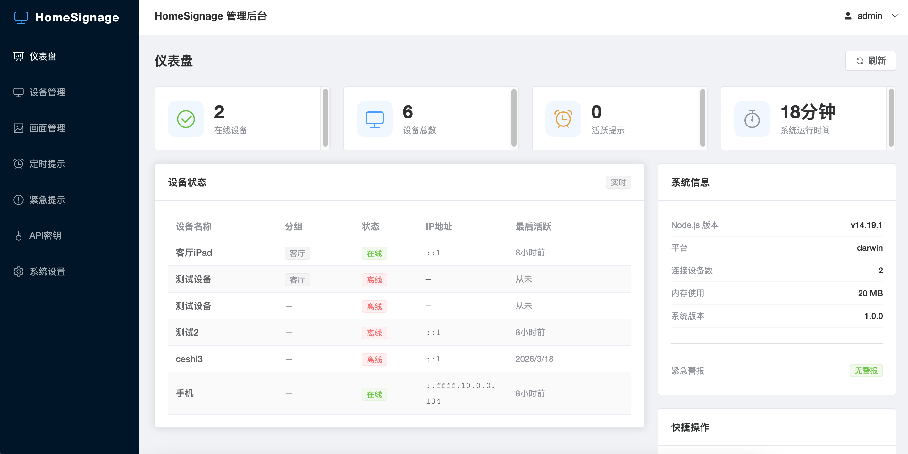
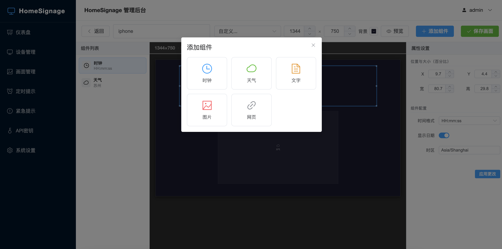
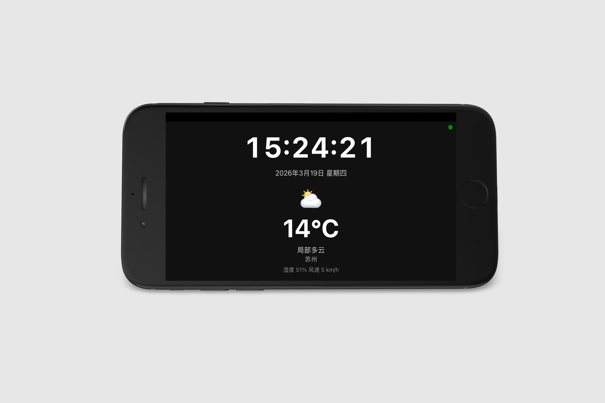
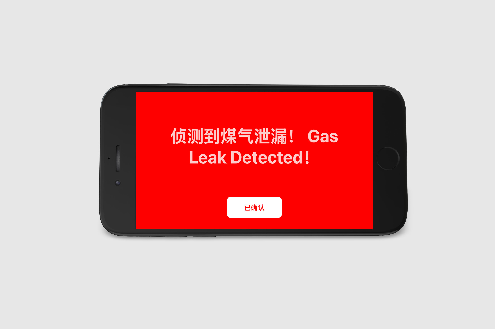

# HomeSignage

**English** | [中文](#中文)

> Turn idle phones, tablets, and old laptops into smart home information displays.

HomeSignage is a self-hosted digital signage system for the home. It supports multi-scene carousels, timed overlays, emergency alerts, real-time weather, a file repository for local media, and a full REST API for integration with home automation systems like HomeAssistant.

---

## Screenshots

| Admin Dashboard | Scene Editor |
|:-:|:-:|
|  |  |

| Device Display | Emergency Alert |
|:-:|:-:|
|  |  |

---

## Features

- **News, stocks and Pig Companion** — Rotate filtered news and hot searches on screen, chart intraday quotes across mainland China, Hong Kong and US markets, and let the companion announce items that affect the household. Family members can use the shared chat page to schedule, change and cancel their own reminders. Administrators can review the chat and action audit.

- **Multi-scene carousel** — Each device shows multiple scenes in rotation with fade transitions; switching is driven by the backend (epoch-clock) to eliminate client-side timer drift and black-screen issues on long-running displays
- **Rich components** — Clock, weather, text, image, video, iframe, info list
- **Video component** — Plays local or remote video files with configurable autoplay, loop, and mute settings
- **File repository** — Upload images, audio, and video to a local folder; files can also be dropped in manually. All media assets are available to select directly in the scene editor and reminder settings
- **Info list** — A shared bulletin board of timestamped items (info / important / urgent) shown across all scenes; supports horizontal marquee and paginated display with fade transitions
- **Timed reminders** — Overlay banners on a schedule: daily / weekdays / weekends / one-time
- **Emergency alerts** — Full-screen red alert pushed to all devices in under 2 seconds, with looping audio
- **Pluggable weather providers** — wttr.in (no API key required) or QWeather/和风天气 (API key required); city search with country → province → city autocomplete; refresh interval configurable per component (hours, minimum 1 h); same city fetched only once regardless of how many scenes reference it; stale cached data shown on fetch failure with a last-updated notice
- **Server time sync (NTP-style)** — Clock components display server time, not device time; round-trip latency compensation ensures sub-millisecond accuracy on LAN; re-syncs every 5 minutes to correct drift; devices with incorrect system clocks (e.g. old iPads without internet time) show the correct time automatically
- **Offline content support** — Media assets referenced in scenes are automatically downloaded from the file repository to the display device for isolated networks without direct server access
- **Iframe proxy with base-href injection** — External web pages are fetched server-side and cached; relative URLs inside proxied pages are rewritten to resolve against the original host, eliminating 404 errors
- **Real-time updates** — Scene changes and info list edits are pushed instantly to all displays via Socket.IO
- **Offline resilience** — Devices fall back to cached content when the network is unavailable; the scene carousel continues locally until the connection is restored
- **Device status dashboard** — Admin devices page shows each device's online status and the scene it is currently displaying (thumbnail + name)
- **Open REST API** — Control content and trigger alerts from external systems using API keys
- **Web admin UI** — Vue.js dashboard to manage all devices, scenes, reminders, and files

---

## Quick Start

### Option 1: Docker (recommended)

```bash
git clone <repo-url>
cd HomeSignage

cp .env.example .env          # edit .env — set JWT_SECRET at minimum

docker-compose up -d
docker-compose logs -f
```

### Option 2: Local Node.js

**Tested local runtime**: Node.js 24. The container uses Node.js 22 and builds the admin dashboard from source.

```bash
npm install
cd admin && npm install && npm run build && cd ..

cp .env.example .env          # edit .env — set JWT_SECRET at minimum

npm start
```

Once running:
- Admin UI → `http://localhost:3000/admin`
- Display client → `http://localhost:3000/client`

---

## Environment Variables

| Variable | Default | Description |
|----------|---------|-------------|
| `PORT` | `3000` | Server port |
| `JWT_SECRET` | *(required)* | JWT signing secret — use a random string |
| `SQLITE_PATH` | `./data/signage.db` | SQLite database path |
| `LOG_LEVEL` | `info` | Log level: `debug` / `info` / `warn` / `error` |
| `NODE_ENV` | `development` | Runtime environment |
| `FILE_REPO_PATH` | `./file-repo` | Path to the file repository directory |
| `GLM_API_KEY`, `DEEPSEEK_API_KEY`, `BRAVE_API_KEY` | Optional | Server-side credentials for the selected model or Brave News source |

---

## Setup Guide

### 1. Log in to the admin panel

Open `http://<server-ip>:3000/admin` and log in with the default credentials:

- Username: `admin`
- Password: `admin123`

> ⚠️ Change your password immediately in **System Settings** after first login.

---

### 2. Add display devices

1. Go to **Devices** → **Add Device**
2. Enter a name (e.g. "Living Room iPad") and optional group
3. After creation, copy the device URL shown:
   ```
   http://<server-ip>:3000/client?deviceId=xxx&deviceKey=xxx
   ```
4. Open this URL in the browser on your display device — use fullscreen / kiosk mode

> **iOS/iPadOS tip**: In Safari, tap Share → Add to Home Screen for a full-screen, chrome-free experience.

The devices page shows each device's online status and the scene it is currently displaying, so you can confirm at a glance that every screen is showing the right content.

---

### 3. Configure weather provider (optional)

Go to **System Settings** → **Weather Service** to choose a provider:

| Provider | API Key | City search | Notes |
|----------|---------|-------------|-------|
| wttr.in | Not required | Not supported (type city name manually) | Good for casual use |
| QWeather (和风天气) | Required | Autocomplete with country/province/city hierarchy | More accurate for China |

To use QWeather:
1. Register at [qweather.com](https://www.qweather.com) and obtain a free API key
2. In **System Settings**, select **QWeather** as the provider and paste the API key
3. In the scene editor, use the city search field to find and select a city — the location ID is stored automatically for accurate results

---

### 4. Manage the file repository (optional)

Go to **文件仓库** in the sidebar to upload and manage media files.

| Operation | Description |
|-----------|-------------|
| Upload | Drag and drop or click to upload images, audio, or video (up to 200 MB each) |
| Download | Download any file to your local machine |
| Rename | Rename files in-place |
| Delete | Remove files from the repository |

You can also drop files directly into the `file-repo/` folder on the server — they will appear immediately in the repository browser.

Once uploaded, files can be selected directly when configuring an **Image**, **Video**, or **Sound** field anywhere in the admin — no need to type a URL manually.

---

### 5. Create scenes

1. Go to **Scenes** → **New Scene**
2. Set the canvas resolution to match your display (presets included for common sizes)
3. Add components from the left panel:

| Component | Purpose | Key config |
|-----------|---------|------------|
| Clock | Current time and date | 24h/12h format, timezone — displays **server time**, unaffected by device clock accuracy |
| Weather | Live weather data | City name (or search if using QWeather), °C / °F, refresh interval (hours) |
| Stocks | Latest price, change and intraday trend | Mainland (including ChiNext/STAR/BSE), Hong Kong and US; automatic, fixed-price or previous-close percentage scale |
| Text | Notices, reminders | Content, font size, color |
| Image | Display a photo | URL or pick from file repository |
| Video | Play a video file | URL or pick from file repository; autoplay / loop / mute |
| Webpage | Embed an external page | Target URL; server-side cached proxy with automatic relative-URL rewriting |
| Info List | Shared bulletin board fed from the global info-items list | Font, colors, scroll speed, page interval |

4. Drag components to position them, or enter x/y/width/height values (percentage-based)
5. Click **Save Scene** — connected displays update instantly

---

### Stock component

Choose **Add Component → Stocks**, enter a symbol (`600519`, `300750`, `688981`, `bj920001`, `00700`, `AAPL`, `BRK-B`), then click **Apply**. The price scale can fit automatically, use fixed price bounds, or show a percentage range around the previous close. Refresh defaults to 60 seconds (configurable from 30 to 3600). Mainland/Hong Kong data comes from Tencent Finance; US regular-session data comes from Yahoo Finance. Quotes may be delayed. The widget shows the exchange timezone and quote date, including the latest trading day when markets are closed, and retains marked cached data on failure. See `GET /api/v1/stocks?symbol=AAPL&market=us` in Swagger.

### 6. Assign scenes to devices

1. Go to **Devices** → click **Scenes** on the target device
2. Check the scenes to display and set the duration (in seconds) for each
3. Use the arrow buttons to set the carousel order
4. Save — the device reloads its config immediately via Socket.IO

Scene switching is driven by the backend using an epoch-based clock, so all devices assigned the same scene list stay in sync, and reconnecting devices immediately show the correct scene without restarting from the beginning.

---

### 7. Set up timed reminders (optional)

Go to **Timed Reminders** → **Create Reminder**

| Parameter | Description |
|-----------|-------------|
| Time window | Start and end time (e.g. 08:00 – 08:30) |
| Repeat | None / Daily / Weekdays / Weekends |
| Target devices | Which devices to show the reminder on |
| Content | Message text |
| Style | Top bar / Bottom bar / Center / Blink |
| Priority | 1–10 (higher = takes precedence when overlapping) |
| Sound | Optional audio file — enter a URL or pick from the file repository |

Reminders overlay the scene carousel without interrupting it. Multiple reminders at the same position rotate with fade transitions.

**Examples**:
- Weekdays 08:00–08:15: "Don't forget your keys!"
- Daily 20:00–20:30: "Time to drink water"
- Weekends 09:00–09:30: "Trash day — take out the bins"

---

### 8. Manage info list items (optional)

Go to **Info List** in the sidebar to add, edit, or delete bulletin items.

| Field | Description |
|-------|-------------|
| Type | **Info** (blue) · **Important** (yellow) · **Urgent** (red) |
| Content | The message text to display |
| Start time | Leave blank to show immediately |
| End time | Leave blank for a permanent item; expired items are auto-removed |

Each scene that contains an **Info List** component shares the same global list of items. Per-component settings (font, background, scroll speed, page interval) are configured in the scene editor.

**Display behaviour**:
- Two-column layout: coloured type badge on the left, message text on the right
- If text is wider than the component, it scrolls horizontally (left → right, seamless loop)
- If the list is taller than the component, it paginates with a configurable fade interval

Any change to the list is pushed instantly to all connected displays via Socket.IO.

---

### 9. Trigger emergency alerts (optional)

1. Go to **Emergency Alerts** → **Trigger Alert**
2. Write the alert message and choose target devices
3. Optionally select an audio file from the file repository for the alarm sound
4. Click **Trigger** — all target devices immediately go full-screen red
5. Click **Clear** when the situation is resolved — devices return to normal

---

## API Integration

External systems (e.g. HomeAssistant, n8n) can control HomeSignage via REST API.

### Authentication

Generate an API key in the admin panel under **API Keys**, then include it in requests:

```
X-API-Key: your-api-key
```

### Examples

**Trigger an emergency alert**
```bash
curl -X POST http://<server>:3000/api/v1/reminders/emergency \
  -H "X-API-Key: your-key" \
  -H "Content-Type: application/json" \
  -d '{
    "device_ids": ["all"],
    "content": {
      "text": "Gas leak! Evacuate immediately!",
      "backgroundColor": "#FF0000",
      "textColor": "#FFFFFF",
      "blink": true
    },
    "sound": { "file": "alarm.mp3", "volume": 1.0, "loop": true }
  }'
```

**Clear an emergency alert**
```bash
curl -X DELETE http://<server>:3000/api/v1/reminders/emergency/<alertId> \
  -H "X-API-Key: your-key"
```

**Create a timed reminder**
```bash
curl -X POST http://<server>:3000/api/v1/reminders/timed \
  -H "X-API-Key: your-key" \
  -H "Content-Type: application/json" \
  -d '{
    "name": "Morning reminder",
    "device_ids": ["all"],
    "start_time": "08:00",
    "end_time": "08:30",
    "repeat": "weekday",
    "content": {
      "text": "Do not forget your wallet!",
      "style": "blink",
      "color": "#ffffff",
      "backgroundColor": "#ff6600"
    },
    "priority": 7
  }'
```

**Upload a file to the repository**
```bash
curl -X POST http://<server>:3000/api/v1/file-repo \
  -H "Authorization: Bearer <token>" \
  -F "file=@/path/to/video.mp4"
```

### API Reference

The table lists frequently used calls. Interactive OpenAPI is served at `/api/docs/` and its JSON at `/api/docs.json`. These include the news catalog and preferences, companion memory, chat audit, display receipts, stock quotes and video byte ranges. Guest chat uses a per-browser session cookie at `/pig-chat`. See the [system regression procedure](docs/系统回归测试.md) for executable acceptance cases and verification limits.

| Method | Path | Description |
|--------|------|-------------|
| GET | `/api/v1/devices` | List all devices (includes current scene per device) |
| GET | `/api/v1/devices/:id/config` | Get device config (used by client) |
| PUT | `/api/v1/devices/:id/scenes` | Update device scene list |
| POST | `/api/v1/devices/:id/refresh` | Force device to reload config |
| GET | `/api/v1/scenes` | List all scenes |
| GET | `/api/v1/weather?city=Beijing` | Get live weather data |
| GET | `/api/v1/weather/providers` | List available weather providers |
| GET | `/api/v1/weather/locations?query=` | Search city/location (QWeather only) |
| GET | `/api/v1/settings` | Get system settings (weather provider, API key, etc.) |
| PUT | `/api/v1/settings` | Update system settings |
| POST | `/api/v1/reminders/timed` | Create a timed reminder |
| PUT | `/api/v1/reminders/timed/:id` | Update a timed reminder |
| DELETE | `/api/v1/reminders/timed/:id` | Delete a timed reminder |
| POST | `/api/v1/reminders/emergency` | Trigger an emergency alert |
| DELETE | `/api/v1/reminders/emergency/:id` | Clear an emergency alert |
| GET | `/api/v1/reminders/emergency/active` | List active alerts |
| GET | `/api/v1/info-items` | List all info items (admin) |
| GET | `/api/v1/info-items/active` | List currently active items (display clients) |
| POST | `/api/v1/info-items` | Create an info item |
| PUT | `/api/v1/info-items/:id` | Update an info item |
| DELETE | `/api/v1/info-items/:id` | Delete an info item |
| GET | `/api/v1/file-repo` | List files in repository (`?type=image\|audio\|video`) |
| POST | `/api/v1/file-repo` | Upload a file (multipart, max 200 MB) |
| GET | `/api/v1/file-repo/:filename/download` | Download a file |
| PATCH | `/api/v1/file-repo/:filename` | Rename a file |
| DELETE | `/api/v1/file-repo/:filename` | Delete a file |

---

## Architecture

```
HomeAssistant / n8n / External Systems
           ↓  REST API  (X-API-Key)
    Node.js + Express + Socket.IO
           ↓  HTTP + WebSocket
    ┌──────────────────────────────┐
    │  Display clients             │
    │  (iOS Safari, Android Chrome,│
    │   old laptops — Vanilla JS)  │
    └──────────────────────────────┘
    ┌──────────────────────────────┐
    │  Admin dashboard             │
    │  (Vue.js 3 + Element Plus)   │
    └──────────────────────────────┘
         SQLite  ·  node-schedule
```

**Display priority** (highest to lowest):
1. Emergency alert — full-screen, interrupts everything
2. Timed reminder — overlays the current scene
3. Scene carousel — driven by ScenePlannerService (epoch-clock)

**Key backend services**:

| Service | Responsibility |
|---------|---------------|
| `ScenePlannerService` | Calculates the correct scene for each device every second using an epoch-based clock; pushes `scene-switch` events via Socket.IO |
| `weatherService` | Fetches weather from the configured provider; deduplicates identical city requests; returns stale cache on network failure |
| `schedulerService` | Runs timed reminder start/end jobs using node-schedule |
| `socketService` | Manages device WebSocket connections; handles time-sync requests for NTP-style clock synchronisation |

---

## Project Structure

```
HomeSignage/
├── src/               # Node.js backend
│   ├── index.js       # Entry point
│   ├── config/        # Database schema
│   ├── middleware/     # JWT & API key auth
│   ├── dao/           # SQLite data access layer
│   ├── services/      # Socket.IO, scene planner, weather, scheduler
│   │   └── weather/
│   │       ├── index.js          # Provider registry
│   │       └── providers/
│   │           ├── wttr.js       # wttr.in provider
│   │           └── qweather.js   # QWeather/和风天气 provider
│   ├── controllers/   # Business logic
│   └── routes/        # REST route definitions
├── client/            # Display client (Vanilla JS, iOS-compatible)
├── admin/             # Admin dashboard source (Vue.js 3)
├── admin-dist/        # Built admin dashboard
├── tests/             # Jest unit tests
├── data/              # SQLite database
├── file-repo/         # File repository (images, audio, video)
├── logs/              # Application logs
└── docker-compose.yml
```

---

## Development

```bash
# Terminal 1 — backend with hot reload
npm run dev

# Terminal 2 — admin dashboard with HMR
cd admin && npm run dev
# Open http://localhost:5173/admin

# Run unit tests
npm test
```

---

## Hardware

| Role | Recommended |
|------|-------------|
| Server | Home NAS, Raspberry Pi 4, any low-power mini PC |
| Display | Old iPad/iPhone, old Android tablet, old laptop connected to a monitor |

**Minimum server spec**: 1 CPU core · 512 MB RAM · 1 GB storage (more for video files)

---

---

# 中文

[English](#homesignage) | **中文**

> 将闲置的手机、平板、旧笔记本变成家庭信息展示屏。

HomeSignage 是一个自托管的家庭数字标牌系统，支持多画面轮播、定时提醒叠加、紧急警报推送、实时天气显示、本地文件仓库，并提供完整的 REST API 供家庭自动化系统（如 HomeAssistant）集成。

---

## 功能概览

- **资讯、股票和猪猪伙伴**：资讯与热搜自动轮播。股票展示 A 股（含创业板）、港股和美股的最新价格与分时走势。猪猪根据家庭记忆、行程和资讯判断生活影响；家人可在访客聊天页创建、改期、取消提醒，管理员可查看操作审计。

- **多画面轮播** — 每台设备可配置多个画面按序轮播，淡入淡出切换；画面切换由后端通过纪元时钟驱动，消除客户端定时器漂移导致的闪烁和黑屏问题，长时间运行也稳定
- **丰富组件** — 时钟、天气、文本、图片、视频、网页嵌入（iframe）、信息列表
- **视频组件** — 播放本地或远程视频，支持自动播放、循环播放、静音配置
- **文件仓库** — 上传图片、音频、视频到本地文件夹，也可手动将文件放入目录后直接使用；所有媒体资源可在画面编辑器和提醒设置中直接选取
- **信息列表** — 全局共享的公告条目（提示 / 重要 / 紧急三种类型），支持时效性显示；超宽文字横向滚动，超高内容自动分页淡入淡出
- **定时提醒** — 在指定时段叠加显示提醒条，支持每天 / 工作日 / 周末 / 单次
- **紧急警报** — 全屏红色警报，2 秒内推送到所有设备，循环播放警示音
- **可扩展天气服务商** — 支持 wttr.in（无需 API Key）或和风天气（需 API Key）；和风天气支持国家→省→城市层级下拉搜索；刷新频率可按组件配置（单位：小时，最少 1 小时）；同一城市的天气数据在所有画面之间只拉取一次；请求失败时展示上次缓存数据并显示更新时间
- **服务器时间同步（简易 NTP）** — 时钟组件显示服务器时间而非设备本地时间；采用往返延迟补偿算法，局域网精度优于 1ms；每 5 分钟自动重新同步修正漂移；系统时间不准的旧设备（如无网络时间的旧 iPad）也能显示正确时间
- **离线内容支持** — 画面中引用的媒体资源自动下载到显示设备本地，适用于无法直接访问服务器的隔离网络环境
- **Iframe 代理与相对路径修正** — 外部网页由服务器端拉取并缓存；代理内容中的相对 URL 自动重写，指向原始域名，消除 404 错误
- **实时推送** — 画面变更、信息列表增删改均即时通过 Socket.IO 推送给所有显示设备
- **断网缓存** — 网络断开时显示本地缓存内容，画面轮播在本地继续运行，不黑屏
- **设备当前画面展示** — 管理后台设备列表实时显示每台设备正在展示的画面缩略图和名称
- **开放 API** — 支持外部系统通过 API Key 控制内容和触发警报
- **管理后台** — Vue.js Web 界面，统一管理所有设备、内容和文件

---

## 快速开始

### 方式一：Docker 部署（推荐）

```bash
git clone <repo-url>
cd HomeSignage

cp .env.example .env    # 编辑 .env，至少修改 JWT_SECRET

docker-compose up -d
docker-compose logs -f
```

### 方式二：本地直接运行

**已验证的本地运行环境**：Node.js 24。容器使用 Node.js 22，并从源码构建管理后台。

```bash
npm install
cd admin && npm install && npm run build && cd ..

cp .env.example .env    # 编辑 .env，至少修改 JWT_SECRET

npm start
```

服务启动后访问：
- 管理后台：`http://localhost:3000/admin`
- 显示客户端：`http://localhost:3000/client`

---

## 环境变量

| 变量 | 默认值 | 说明 |
|------|--------|------|
| `PORT` | `3000` | 服务监听端口 |
| `JWT_SECRET` | *(必填)* | JWT 签名密钥，请设置为随机字符串 |
| `SQLITE_PATH` | `./data/signage.db` | 数据库文件路径 |
| `LOG_LEVEL` | `info` | 日志级别（debug/info/warn/error） |
| `NODE_ENV` | `development` | 运行环境 |
| `FILE_REPO_PATH` | `./file-repo` | 文件仓库目录路径 |
| `GLM_API_KEY`、`DEEPSEEK_API_KEY`、`BRAVE_API_KEY` | 可选 | 服务端读取所选模型或 Brave News 来源的凭据 |

---

## 使用向导

### 第一步：登录管理后台

访问 `http://<服务器IP>:3000/admin`，使用默认账号登录：

- 用户名：`admin`
- 密码：`admin123`

> ⚠️ 首次登录后请立即在「系统设置」中修改密码。

---

### 第二步：添加显示设备

1. 进入**设备管理**页面，点击「添加设备」
2. 填写设备名称（如"客厅 iPad"）和分组（如"客厅"）
3. 创建成功后复制显示的**专属访问链接**：
   ```
   http://<服务器IP>:3000/client?deviceId=xxx&deviceKey=xxx
   ```
4. 在显示设备的浏览器中打开此链接，建议设置为**全屏 / Kiosk 模式**

> **iOS/iPadOS 提示**：显示端支持 iOS / iPadOS 13 起的 Safari。更新后重新加载显示页面即可。可在 Safari 中点击「分享」→「添加到主屏幕」，即可全屏无地址栏运行。

设备列表实时显示每台设备的在线状态和当前正在展示的画面（缩略图 + 名称），一眼确认所有屏幕内容是否正常。

---

### 第三步：配置天气服务商（可选）

进入**系统设置** → **天气服务设置**，选择天气数据来源：

| 服务商 | API Key | 城市搜索 | 适用场景 |
|--------|---------|----------|----------|
| wttr.in | 不需要 | 不支持（手动输入城市名） | 简单使用 |
| 和风天气 | 需要 | 支持国家/省/城市层级搜索 | 国内用户推荐 |

使用和风天气：
1. 在 [qweather.com](https://www.qweather.com) 注册并获取免费 API Key
2. 在「系统设置」中选择**和风天气**并填入 API Key
3. 在画面编辑器中，时钟/天气组件的城市字段支持搜索并自动保存 Location ID，定位更精准

---

### 第四步：管理文件仓库（可选）

进入侧边栏「**文件仓库**」页面，上传和管理媒体文件。

| 操作 | 说明 |
|------|------|
| 上传 | 拖拽或点击上传图片、音频、视频（单文件最大 200 MB） |
| 下载 | 将文件下载到本地 |
| 重命名 | 在仓库中重命名文件 |
| 删除 | 从仓库中删除文件 |

也可以直接将文件放入服务器上的 `file-repo/` 目录，系统会立即识别并显示。

上传后，所有文件可在**图片组件**、**视频组件**、**声音设置**中点击「从仓库选择」直接使用，无需手动输入 URL。

---

### 第五步：创建画面

1. 进入**画面管理**页面，点击「新建画面」
2. 设置画布分辨率以匹配显示设备（内置常用预设）
3. 在左侧面板添加组件：

| 组件类型 | 用途 | 主要配置 |
|----------|------|----------|
| 时钟 | 显示当前时间和日期 | 24h/12h 格式、时区 — 显示**服务器时间**，不受设备系统时间影响 |
| 天气 | 实时天气（自动获取） | 城市名称（和风天气支持搜索）、温度单位、刷新频率（小时） |
| 股票行情 | 最新价格、涨跌幅和分时走势 | A 股/创业板/科创板/北交所、港股、美股；自动、固定价格、昨收百分比三种比例尺 |
| 文本 | 备忘录、公告等 | 内容、字号、颜色 |
| 图片 | 展示图片 | URL 或从文件仓库选择 |
| 视频 | 播放视频 | URL 或从文件仓库选择；自动播放 / 循环 / 静音 |
| 网页 | 嵌入外部网页 | 目标 URL；服务器端缓存代理，自动修正相对路径 |
| 信息列表 | 显示全局共享的公告条目 | 字号、颜色、背景、横向滚动速度、翻页间隔 |

4. 拖拽组件调整位置和大小，或输入 x/y/宽/高（百分比）精确定位
5. 点击「保存画面」— 已连接的显示设备**即时更新**

---

### 股票组件配置

在画面编辑器中选择「添加组件 → 股票行情」，填写代码后点击「应用更改」。支持 `600519`、`300750`（创业板）、`688981`（科创板）、`bj920001`（北交所）、`00700`（港股）、`AAPL`、`BRK-B`（美股）。可自动识别市场或手动选择；`000001` 默认深市，`sh000001` 指上证指数。

新组件不会默认查询示例股票；必须填写股票代码才会显示行情。股票名称由行情自动返回，不能被备注覆盖。备注只用于标注，不会改变查询对象。例如合康新能应填写 `300048` 或 `sz300048`。

价格轴提供三种比例尺：自动根据价格和昨收缩放；固定价格上下限（例如 330–360）；以昨收为中心上下浮动指定百分比（例如 ±5%）。固定范围外的曲线会裁剪并提示。横轴使用交易所当地时间，A 股与港股压缩午休时段，美股显示常规交易时段。默认每 60 秒刷新，可设 30–3600 秒。

A 股及港股行情来自腾讯财经，美股来自 Yahoo Finance，由服务器访问外网并缓存；展示设备只访问本系统。组件会标明行情时间、时区和来源，休市时显示最近交易日，外部数据可能延迟或暂不可用。更新失败会保留上次行情并标记缓存；同一代码在多个设备间共享服务端请求。接口为 `GET /api/v1/stocks?symbol=AAPL&market=us`，具体字段参见 Swagger。

### 第六步：为设备分配画面

1. 在**设备管理**页面，点击目标设备的「画面」按钮
2. 勾选要显示的画面，设置每个画面的显示时长（秒）
3. 通过上下箭头调整轮播顺序
4. 保存后设备通过 Socket.IO 即时收到新配置

画面切换由后端纪元时钟统一驱动，所有配置相同画面列表的设备始终保持同步，断线重连后也会立即切换到正确的画面，不会从头开始。

---

### 第七步：设置定时提醒（可选）

进入**定时提示**页面，点击「创建提示」

| 参数 | 说明 |
|------|------|
| 开始/结束时间 | 例如 08:00 – 08:30 |
| 重复规则 | 不重复 / 每天 / 工作日 / 周末 |
| 目标设备 | 选择哪些设备显示提醒 |
| 提示内容 | 显示的文字 |
| 显示样式 | 顶部条 / 底部条 / 居中浮窗 / 闪烁 |
| 优先级 | 1–10，同时段多条提醒时数字大的优先 |
| 声音文件 | 可选，输入 URL 或从文件仓库选择音频 |

提醒会**叠加**在画面轮播之上，同一位置有多条时淡入淡出轮播显示。

**使用示例**：
- 工作日 08:00–08:15：「记得带钥匙和饭盒！」
- 每天 20:00–20:30：「该喝水了」
- 周末 09:00–09:30：「今天是垃圾日，记得扔垃圾」

---

### 第八步：管理信息列表（可选）

进入侧边栏「**信息列表**」页面，添加、编辑或删除公告条目。

| 字段 | 说明 |
|------|------|
| 类型 | **提示**（蓝色）· **重要**（黄色）· **紧急**（红色） |
| 信息内容 | 要显示的文字 |
| 开始时间 | 不填则立即显示 |
| 结束时间 | 不填则永久保留；过期条目每小时自动清理 |

所有包含**信息列表组件**的画面共享同一套全局条目，每个组件可单独配置字体、背景、滚动速度和翻页间隔。

**显示效果**：
- 两列布局：左列为彩色类型标签，右列为信息文字
- 文字超出组件宽度时横向无缝滚动
- 条目超出组件高度时分页显示，页切换淡入淡出

对信息列表的任何修改都会**即时**通过 Socket.IO 推送给所有已连接的显示设备。

---

### 第九步：触发紧急警报（可选）

1. 进入**紧急提示**页面
2. 点击红色「触发紧急警报」按钮
3. 填写警报内容，选择目标设备
4. 可选择从文件仓库选取警报声音
5. 点击「立即触发」— 目标设备立即全屏显示红色警报
6. 处理完毕后点击「解除警报」，设备恢复正常显示

---

## API 集成

外部系统（如 HomeAssistant、n8n）可通过 REST API 控制显示内容。

### 获取 API 密钥

在管理后台「API 密钥」页面生成密钥，在请求头中携带：

```
X-API-Key: your-api-key
```

### 常用 API 示例

**触发紧急警报**
```bash
curl -X POST http://<server>:3000/api/v1/reminders/emergency \
  -H "X-API-Key: your-key" \
  -H "Content-Type: application/json" \
  -d '{
    "device_ids": ["all"],
    "content": {
      "text": "煤气泄漏！请立即撤离！",
      "backgroundColor": "#FF0000",
      "textColor": "#FFFFFF",
      "blink": true
    },
    "sound": { "file": "alarm.mp3", "volume": 1.0, "loop": true }
  }'
```

**解除紧急警报**
```bash
curl -X DELETE http://<server>:3000/api/v1/reminders/emergency/<alertId> \
  -H "X-API-Key: your-key"
```

**创建定时提醒**
```bash
curl -X POST http://<server>:3000/api/v1/reminders/timed \
  -H "X-API-Key: your-key" \
  -H "Content-Type: application/json" \
  -d '{
    "name": "出门提醒",
    "device_ids": ["all"],
    "start_time": "08:00",
    "end_time": "08:30",
    "repeat": "weekday",
    "content": {
      "text": "记得带钱包！",
      "style": "blink",
      "color": "#ffffff",
      "backgroundColor": "#ff6600"
    },
    "priority": 7
  }'
```

**上传文件到仓库**
```bash
curl -X POST http://<server>:3000/api/v1/file-repo \
  -H "Authorization: Bearer <token>" \
  -F "file=@/path/to/video.mp4"
```

### 完整 API 列表

完整接口以运行中的 `/api/docs/` 和 `/api/docs.json` 为准。下面列常用调用。股票使用 `/api/v1/stocks`，资讯订阅和话题偏好在 `/api/v1/news` 下，家庭记忆和审计在 `/api/v1/companion/agent` 下。访客聊天入口为 `/pig-chat`，使用独立访客 Cookie。全系统的准备步骤、逐项用例、通过条件和实测范围见[系统回归测试](docs/系统回归测试.md)。

| 方法 | 路径 | 说明 |
|------|------|------|
| GET | `/api/v1/devices` | 获取所有设备（含每台设备当前画面信息） |
| GET | `/api/v1/devices/:id/config` | 获取设备配置（客户端专用） |
| PUT | `/api/v1/devices/:id/scenes` | 更新设备画面列表 |
| POST | `/api/v1/devices/:id/refresh` | 强制设备刷新配置 |
| GET | `/api/v1/scenes` | 获取所有画面 |
| GET | `/api/v1/weather?city=北京` | 获取实时天气数据 |
| GET | `/api/v1/weather/providers` | 列出可用天气服务商 |
| GET | `/api/v1/weather/locations?query=` | 搜索城市（仅和风天气） |
| GET | `/api/v1/settings` | 获取系统设置（天气服务商、API Key 等） |
| PUT | `/api/v1/settings` | 更新系统设置 |
| POST | `/api/v1/reminders/timed` | 创建定时提醒 |
| PUT | `/api/v1/reminders/timed/:id` | 更新定时提醒 |
| DELETE | `/api/v1/reminders/timed/:id` | 删除定时提醒 |
| POST | `/api/v1/reminders/emergency` | 触发紧急警报 |
| DELETE | `/api/v1/reminders/emergency/:id` | 解除紧急警报 |
| GET | `/api/v1/reminders/emergency/active` | 查询活跃警报 |
| GET | `/api/v1/info-items` | 获取所有信息条目（管理端） |
| GET | `/api/v1/info-items/active` | 获取当前有效条目（显示客户端） |
| POST | `/api/v1/info-items` | 创建信息条目 |
| PUT | `/api/v1/info-items/:id` | 更新信息条目 |
| DELETE | `/api/v1/info-items/:id` | 删除信息条目 |
| GET | `/api/v1/file-repo` | 列出仓库文件（`?type=image\|audio\|video`） |
| POST | `/api/v1/file-repo` | 上传文件（multipart，最大 200 MB） |
| GET | `/api/v1/file-repo/:filename/download` | 下载文件 |
| PATCH | `/api/v1/file-repo/:filename` | 重命名文件 |
| DELETE | `/api/v1/file-repo/:filename` | 删除文件 |

---

## 系统架构

```
HomeAssistant / n8n / 外部系统
        ↓  REST API  (X-API-Key)
  Node.js + Express + Socket.IO
        ↓  HTTP + WebSocket
  ┌──────────────────────────────┐
  │  显示客户端                   │
  │  （iOS Safari、Android Chrome │
  │   旧笔记本 — Vanilla JS）     │
  └──────────────────────────────┘
  ┌──────────────────────────────┐
  │  管理后台                     │
  │  （Vue.js 3 + Element Plus）  │
  └──────────────────────────────┘
       SQLite  ·  node-schedule
```

**显示优先级**（从高到低）：
1. 紧急警报 — 全屏覆盖，打断一切
2. 定时提醒 — 叠加在画面上方
3. 画面轮播 — 由 ScenePlannerService 纪元时钟驱动

**核心后端服务**：

| 服务 | 职责 |
|------|------|
| `ScenePlannerService` | 每秒通过纪元时钟计算各设备应显示的画面，通过 Socket.IO 推送 `scene-switch` 事件 |
| `weatherService` | 从配置的服务商拉取天气；相同城市请求去重；网络故障时返回缓存数据 |
| `schedulerService` | 使用 node-schedule 运行定时提醒的开始/结束任务 |
| `socketService` | 管理设备 WebSocket 连接；处理 NTP 时间同步请求 |

---

## 项目结构

```
HomeSignage/
├── src/               # 后端 Node.js 代码
│   ├── index.js       # 入口文件
│   ├── config/        # 数据库配置
│   ├── middleware/     # JWT & API Key 认证
│   ├── dao/           # 数据访问层（SQLite）
│   ├── services/      # Socket.IO、场景规划、天气、定时调度
│   │   └── weather/
│   │       ├── index.js          # 服务商注册表
│   │       └── providers/
│   │           ├── wttr.js       # wttr.in 服务商
│   │           └── qweather.js   # 和风天气服务商
│   ├── controllers/   # 业务逻辑
│   └── routes/        # 路由定义
├── client/            # 显示客户端（Vanilla JS，兼容 iOS）
├── admin/             # 管理后台源码（Vue.js 3）
├── admin-dist/        # 管理后台构建产物
├── tests/             # Jest 单元测试
├── data/              # SQLite 数据库文件
├── file-repo/         # 文件仓库（图片、音频、视频）
├── logs/              # 运行日志
└── docker-compose.yml
```

---

## 开发模式

```bash
# 终端 1：启动后端（热重载）
npm run dev

# 终端 2：启动管理后台开发服务器（HMR，代理到 :3000）
cd admin && npm run dev
# 访问 http://localhost:5173/admin

# 运行单元测试
npm test
```

---

## 资讯与猪猪伙伴

在画面编辑器选中「猪猪伙伴」，可设置「气泡字号」（16–72 px，默认 28 px）。修改时可直接预览，点击「应用更改」后，屏幕上的问候和提醒都使用所选字号。

打开管理后台的「资讯 → 订阅来源」，从「选择常用来源」中选择一个频道，再点「订阅所选来源」。可选中新网（国内、社会、财经）、IT之家、少数派、Solidot、百度热搜和联合早报，无需填写网址或申请密钥。百度热搜按榜单名次采集，属于组件中的「热搜」；其他频道属于「新闻」。已订阅的来源会标出，不会覆盖已有设置。订阅后可编辑采集间隔、停用或移除；新来源沿用「话题偏好」的关注和排除规则。

话题可以写成自然语言，如「影响苏州通勤的消息」。系统优先用「模型设置」中的 GLM 或 DeepSeek，结合标题、简述和来源链接判断；命中任意不感兴趣的话题会优先排除。来源的关注词、地区和屏幕资讯组件的关注词也采用语义判断。同一模型对相同内容和偏好的判断会复用，重复采集和屏幕刷新无需重复消耗额度。模型不可用、返回无效结果或共享的次数或令牌额度不足时，系统对尚未判定的条目回退到关键词匹配。「立即采集」会显示回退原因，下次采集会再次尝试模型。

「自定义来源」仍支持 RSS/Atom、联合早报、Brave News 或榜单 JSON。联合早报直接读取官网新闻索引，提供标题、发布时间与原文链接，支持中港台、国际、新加坡、财经和最新栏目。如果官网按地区跳转到中国版，就从官网即时新闻页提取带有明确发布时间的标题和链接。在「模型设置」测试已保存的 GLM 或 DeepSeek 设置。左侧「模型设置」可以设置或更换 GLM、DeepSeek 和 Brave 的 API Key，保存即生效，后台仅显示配置状态。服务端优先使用保存的密钥，也支持原有环境变量。每日模型调用次数和令牌数可分别设为具体数值或不限额，均按 UTC 日期累计。

在画面编辑器可独立添加「资讯列表」或「猪猪伙伴」。资讯列表每次展示一条标题、来源和简述，自动淡入淡出轮播。新闻和热搜可同时勾选，多个关注词命中任一项即可。每条默认停留 10 秒，可设置为 2–600 秒。选中猪猪组件，在「猪猪形象」选择「3D 玩偶」或「2D 插画」，从「选择样貌」挑选 16 款造型之一，再点击「应用更改」。新建组件默认使用 3D，旧组件可手动切换。设备无法运行 WebGL 时自动使用插画。猪猪和说话气泡会随场景一起显示。待机气泡按组件时区每五分钟换一句，节日当天会送上祝福，中国大陆放假期间也会显示假期问候。当前内置 2026、2027 年公布的放假安排。问候只显示文字，重要提醒优先播报，结束后恢复当时的问候。订阅资讯自动发布。在「资讯 → 话题偏好」输入感兴趣和不感兴趣的话题。关注列表留空时接收全部，排除列表优先。偏好适用于在屏卡片和猪猪新闻提醒。

打开「猪猪伙伴 → 家庭记忆」，像写 MEMORY.md 一样用自由文本记录任何想让助手记住的事，最多 12,000 个字符。原先的家庭人数、地址和路线会自动整理到文档里；家庭时区单独设置。记忆供全家聊天与资讯影响判断共同使用，连同必要的对话与计划发送给左侧「模型设置」选定的 GLM 或 DeepSeek。

管理页顶部提供「家庭聊天链接」，任何能打开这个链接的人都可以聊天。默认使用访问后台时的主机和端口；在 Docker 环境可通过 `PIG_CHAT_PUBLIC_ORIGIN=http://192.168.10.204:3000` 指定分享地址。访客从独立页面 `/pig-chat` 聊天，不需要后台账号。可选填称呼，也可直接发消息，如“下个月 12 日坐 MU5123 从上海虹桥去北京”。同一浏览器保留 30 天会话，刷新可看到自己的最近 40 次成功对话；其他访客看不到这些聊天或修改你的计划。管理员仍可在后台管理全家的计划。聊天页面同源提交消息，审计记录服务器实际连接的对端地址。

「猪猪伙伴 → 聊天审计」仅管理员可访问。后台和访客的有效发送都会先在本机数据库记录，再调用模型；保留发送时间、来源 IP、自填称呼或后台用户名、会话、原文、回复和处理结果。记录按时间倒序分页，模型失败和重试也留痕；升级前的成功对话标作“历史后台”，不补造来源地址。访客称呼不是实名验证。

打开「画面编辑器」，选中猪猪组件，展开「提醒、声音与免打扰」，修改后点击「应用更改」。同一场景投放到多个屏幕时共用组件设置；同一屏幕上的不同场景可以有不同规则。旧猪猪首次升级会从已绑定设备的规则迁移；若同一场景绑定了多个规则不同的设备，优先启用的绑定，再按播放顺序和设备 ID 选择一套。提醒播放次数按屏幕及组件分别计算。封路等持续影响默认间隔 60 分钟，最多 3 次（含首次）；设为 1 次关闭重复。

后台或访客聊天都可请猪猪创建系统记录。“明早八点提醒我准备出门去机场”会创建一次性定时提示，默认显示 5 分钟。“今晚 18:00 至 23:00 在信息列表提示给特斯拉充电”会创建这段时间有效的家庭信息。

在同一段聊天里说“查看我的提醒和信息列表”，可以看到记录编号和按家庭时区显示的时间。说“航班改了，明早去机场的提醒推迟半小时”，猪猪会保留原编号和时长，把 08:00–08:05 调整到 08:30–08:35。也可以说“把充电信息的正文改成‘拔掉充电枪’”或“取消去机场的提醒”。同名记录可用清单中的短编号指定，如“取消提醒 #12ab34cd”。后台的聊天审计保留操作类型、原编号以及修改前后的内容和时间。每个访客会话只管理自己创建的记录。

在场景的猪猪伙伴组件中，可同时勾选家庭事项和降温提醒。打开降温提醒后只需填写城市，例如「深圳市」；同名城市可写「省份/城市」。保存时会核对城市名称。系统按该市连续两天的晨间最高温预报和所设温差判断是否提醒，换市后重新积累记录。字幕自动显示；首次启用声音时需在屏幕触摸一次，解锁浏览器朗读。

完整接口见服务的 `/api/docs`，机器可读文档为 `/api/docs.json`。[接口指南](docs/接口指南.md)列出接入流程、凭据与重试规则；[系统回归测试](docs/系统回归测试.md)和[资讯与伙伴测试用例](docs/资讯与猪猪伙伴测试用例.md)提供复跑步骤。

## 硬件推荐

| 角色 | 推荐设备 |
|------|----------|
| 服务器 | 家庭 NAS、树莓派 4、低功耗小主机 |
| 显示终端 | 旧 iPad/iPhone、旧 Android 平板、旧笔记本接显示器 |

**服务器最低配置**：1 核 CPU · 512 MB 内存 · 1 GB 存储（存放视频文件需更多）
